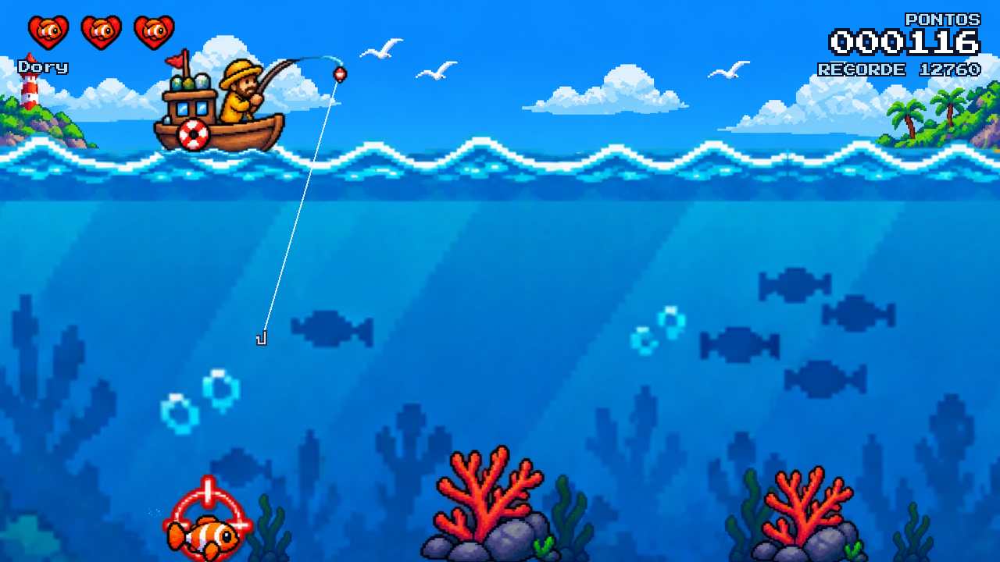
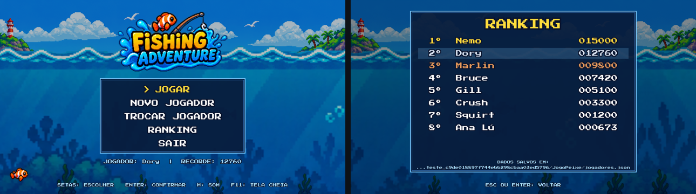
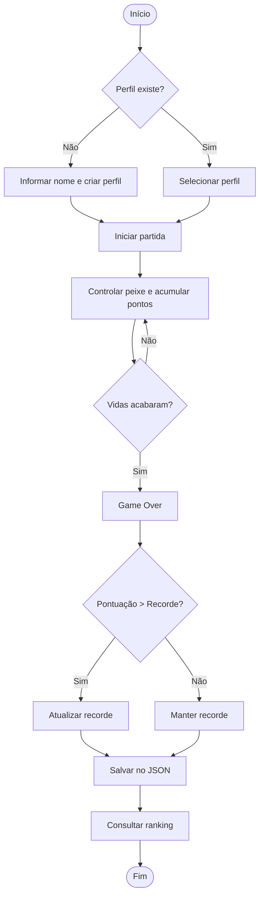
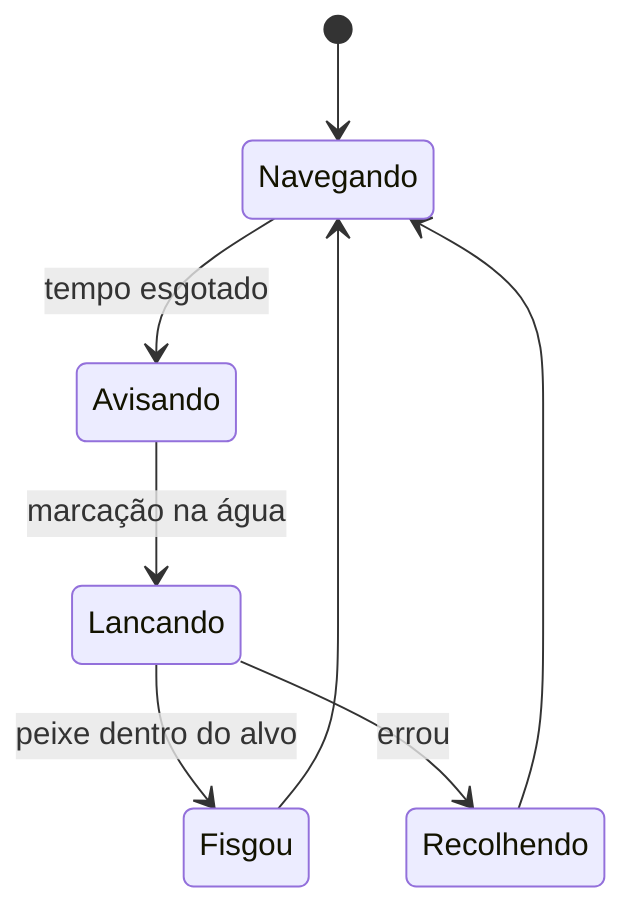

<div align="center">

# 🐟 Jogo do Peixe

**Nade, desvie e escape do anzol pelo maior tempo possível.**

Um endless runner 2D feito em C# com MonoGame, com perfis de jogador e ranking persistente.


</div>

<p align="center">
  
</p>

---

## Sobre o jogo

Você controla um peixe nadando pelo oceano enquanto um pescador, de cima do barco, tenta fisgá-lo. Antes de cada tentativa, uma marcação vermelha aparece na água indicando onde o anzol vai cair: se o peixe estiver dentro da área quando o anzol chegar, perde uma vida. No caminho também surgem corais, lixo, águas-vivas e redes que precisam ser evitados.

O objetivo é simples: sobreviver o máximo possível e acumular a maior pontuação. Cada jogador tem seu próprio perfil, e os recordes ficam salvos para disputar o topo do ranking.

> Projeto desenvolvido para a disciplina de **Linguagens de Programação**, com o objetivo de explorar recursos da linguagem C# em um sistema real: orientação a objetos, herança e polimorfismo, eventos, coleções e LINQ, controle de estados, detecção de colisões e persistência de dados.

<p align="center">
  
</p>

## Funcionalidades

**Partida**
- Peixe controlado pelo teclado, com aceleração suave
- Cenário em camadas com efeito parallax
- Obstáculos variados: corais, lixo (lata, garrafa, sacola, pneu), águas-vivas e redes
- Pescador que persegue o peixe e marca na água onde vai lançar o anzol
- 3 vidas, invulnerabilidade temporária após levar dano e tremor de tela
- Dificuldade crescente: o mundo acelera e os obstáculos e as pescarias ficam mais frequentes
- Pontuação em tempo real, aviso de novo recorde e tela de Game Over
- Pausa, sons e músicas em estilo 8-bit

**Jogadores (CRUD)**
- **Cadastrar** um novo perfil (recorde inicial igual a zero)
- **Consultar** o ranking com os 10 melhores recordes
- **Atualizar** o recorde automaticamente ao fim da partida
- **Excluir** perfis, com confirmação

**Persistência**
- Jogadores e recordes salvos em arquivo JSON
- Dados carregados ao iniciar e mantidos após fechar o jogo
- Gravação segura (arquivo temporário) e recuperação de arquivo corrompido

## Controles

| Tecla | Ação |
|---|---|
| Setas ou WASD | Nadar / navegar nos menus |
| Enter ou Espaço | Confirmar |
| Esc | Voltar / pausar |
| P | Pausar e continuar |
| M | Ligar e desligar o som |
| F11 ou Alt+Enter | Tela cheia |
| Delete ou X | Excluir jogador (na tela de seleção) |
| F3 | Mostrar caixas de colisão (modo depuração) |

## Como funciona



O pescador funciona como uma máquina de estados:



Os dados ficam em um arquivo JSON simples, mapeado diretamente para a classe `Jogador`:

```json
[
  { "Nome": "Peixonauta", "Recorde": 15000 },
  { "Nome": "Nemo", "Recorde": 12760 }
]
```

O arquivo fica na pasta de dados do usuário (o caminho completo aparece na tela de ranking):

- **Windows:** `%LOCALAPPDATA%\JogoPeixe\jogadores.json`
- **Linux:** `~/.local/share/JogoPeixe/jogadores.json`

## Estrutura do projeto

```
JogoPeixe/
├── Program.cs                 # ponto de entrada
├── Game1.cs                   # loop principal, janela, troca de telas
├── Jogo/                      # regras da partida
│   ├── Config.cs              # TODAS as constantes de ajuste (velocidades, tempos...)
│   ├── Partida.cs             # junta peixe, pescador, obstáculos, vidas e pontos
│   ├── Peixe.cs               # personagem controlado pelo jogador
│   ├── Pescador.cs            # barco, máquina de estados, marcação e anzol
│   ├── Obstaculo.cs           # corais, lixo, água-viva e rede
│   ├── GeradorObstaculos.cs   # quando e qual obstáculo aparece
│   ├── Cenario.cs             # fundo em camadas (parallax)
│   ├── Particulas.cs          # bolhas
│   └── Hud.cs                 # vidas, pontos e recorde na tela
├── Jogadores/
│   ├── Jogador.cs             # dados de um perfil
│   └── RepositorioJogadores.cs# CRUD + leitura e gravação do JSON
├── Telas/                     # menu, cadastro, seleção, ranking e partida
├── Nucleo/                    # teclado, imagens, sons, fonte, desenho
└── Assets/                    # sprites, cenário, sons (.wav) e fonte
```

## Tecnologias

| | |
|---|---|
| **Linguagem** | C# |
| **Plataforma** | .NET |
| **Framework de jogo** | MonoGame (DesktopGL) |
| **Persistência** | JSON (`System.Text.Json`) |

## Como executar

**Pré-requisitos:** [.NET SDK](https://dotnet.microsoft.com/download) instalado.

```bash
# Clone o repositório
git clone https://github.com/<usuario>/<repositorio>.git
cd <repositorio>

# Restaure as dependências e rode o jogo
dotnet restore
dotnet run
```

Quer deixar o jogo mais fácil ou mais difícil? Os números ficam todos em `Jogo/Config.cs`.

## Créditos dos recursos

- **Sprites e cenário:** imagens em pixel art fornecidas pela equipe.
- **Fonte:** [Press Start 2P](https://fonts.google.com/specimen/Press+Start+2P), de CodeMan38, sob a licença SIL Open Font License 1.1 (ver `Assets/Fonte/OFL.txt`).
- **Sons e músicas:** gerados por síntese em estilo 8-bit especialmente para o jogo.

## Equipe

| Integrante | Responsabilidade |
|---|---|
| Ayssa Hadassa de Paiva Amorim | <!-- preencher --> |
| Maria Luiza da Cruz Furtado | <!-- preencher --> |
| Milleny Vidal | <!-- preencher --> |

As frentes de trabalho do projeto são:

- **Estrutura e mecânica básica:** configuração do MonoGame, personagem, controles e movimentação do cenário
- **Sobrevivência e pontuação:** obstáculos, colisões, pescador, marcações de pesca, vidas, pontuação e Game Over
- **Jogadores e integração:** classe `Jogador`, CRUD de perfis, ranking, leitura e gravação do JSON e integração com a partida

## Fluxo de desenvolvimento

Cada integrante trabalha em uma branch própria. As alterações chegam à `main` por Pull Request, com revisão de outra integrante antes do merge. A `main` guarda sempre a versão integrada e funcional do jogo.

```
feature/sua-parte  →  commit  →  push  →  Pull Request  →  revisão  →  main
```

---

<div align="center">
<sub>Feito com C#, MonoGame e muito café ☕</sub>
</div>
